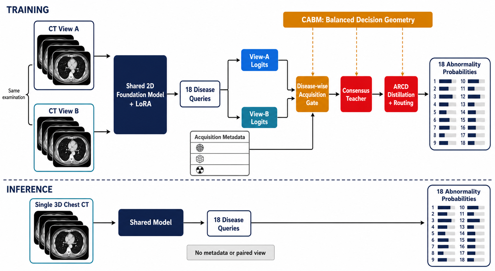
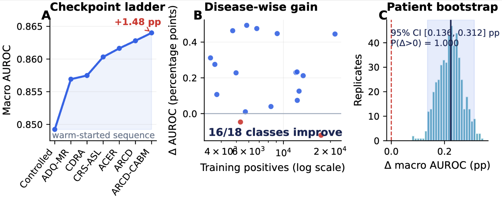
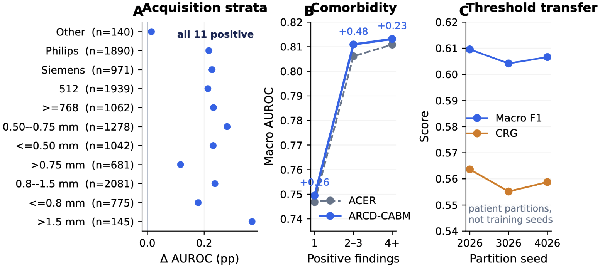
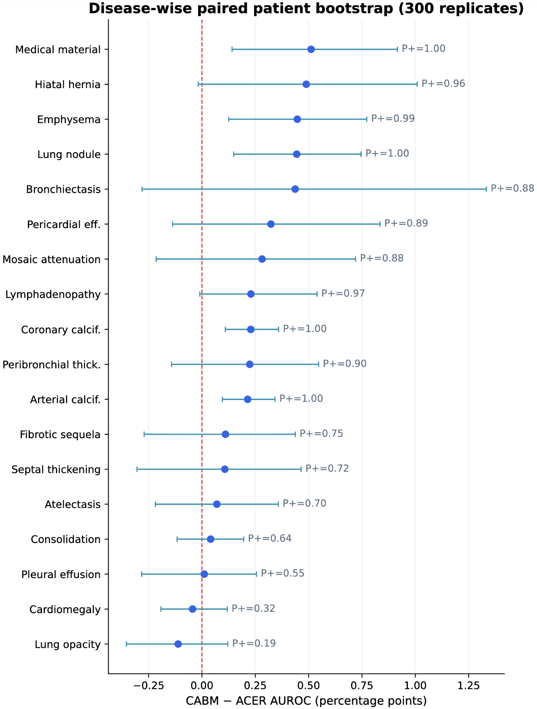
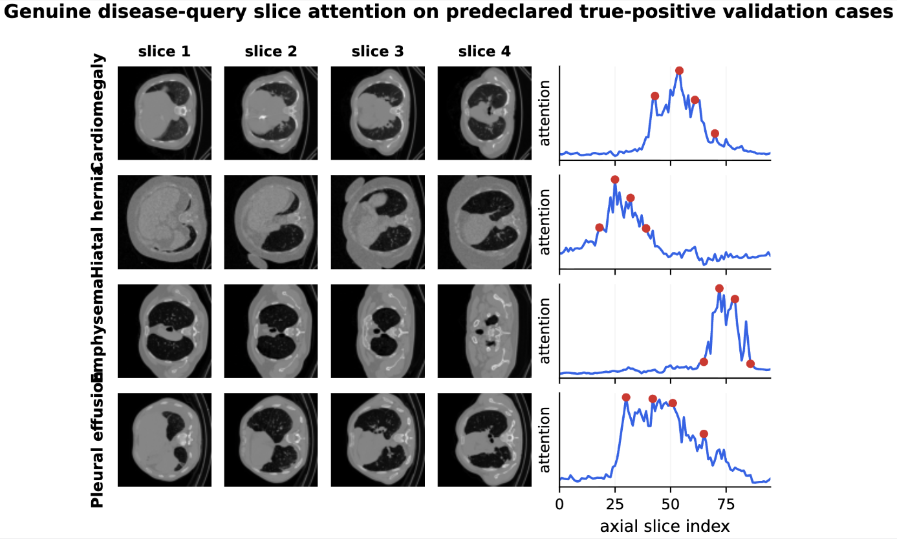

<h1 align="center">
<strong>ARCD-BM: Acquisition-Routed Consensus Distillation with Frequency-Aware Balanced Margins for 3D Chest CT Foundation Models</strong>
</h1>

<div align="center">

[](https://research.forithmus.com/challenges/ct-abnormality-classification)
[](https://huggingface.co/adidukrembzuai/ARCD-BM-checkpoint)
[-8A2BE2?style=for-the-badge)](https://github.com/facebookresearch/dinov2)
[](https://huggingface.co/datasets/ibrahimhamamci/CT-RATE)
[](#-license)

<h3>🤗 <a href="https://huggingface.co/adidukrembzuai/ARCD-BM-checkpoint">Weights</a> &nbsp;|&nbsp; 🧠 <a href="#-method">Method</a> &nbsp;|&nbsp; 🏆 <a href="#-results">Results</a> &nbsp;|&nbsp; ⚡ <a href="#-inference">Inference</a></h3>

**Team genmi:** [Adinath Madhavrao Dukre](https://github.com/adinathdukre), Yifan Lu, Imran Razzak<br/>
Mohamed bin Zayed University of Artificial Intelligence (MBZUAI)

</div>

## 🔥 News
- **[Oct 2026]** 🚀 Code, configurations and the final checkpoint are released.
- **[Aug 2026]** 🏁 Final submission to the VLM3D 2026 CT Abnormality Classification leaderboard (MICCAI 2026).

## Overview
**ARCD-BM** is team genmi's entry to the **VLM3D 2026 CT Abnormality Classification** task. It labels one 3D chest CT volume with 18 abnormalities. A frozen DINOv2 ViT-B/14 encodes 96 axial slices, rank-8 LoRA adapters adapt it, and 18 learned disease queries pool the slices into one logit per abnormality, with only 480,882 trainable parameters.

Training exploits a structure that file-level pipelines ignore: one examination is often reconstructed more than once. **Acquisition-Routed Consensus Distillation (ARCD)** pairs two reconstructions of the same examination, builds a disease-wise teacher from image evidence and acquisition metadata, and distills it into both branches. **Frequency-aware Balanced Margins (BM)** then enlarge positive margins for rare findings and balance the disease-head norms. At inference the model reads a single NIfTI volume, with no metadata and no paired reconstruction.

<p align="center">

<br/>
<em><b>Fig. 1.</b> ARCD-BM. During training (top), two same-examination reconstructions share a frozen slice foundation model, LoRA adapters and disease queries; a disease-wise acquisition gate builds a consensus teacher that is distilled into both branches. During inference (bottom), one 3D CT gives 18 abnormality probabilities. The CT thumbnails in this conceptual schematic are AI-generated illustrations; all qualitative figures below use de-identified CT-RATE images.</em>
</p>

## 📖 Contents
- [🧠 Method](#-method)
- [🏆 Results](#-results)
- [🔍 Qualitative Results](#-qualitative-results)
- [⛏️ Installation](#️-installation)
- [🗃️ Data](#️-data)
- [🧩 Pretrained Weights](#-pretrained-weights)
- [⚡ Inference](#-inference)
- [🏋️ Training](#️-training)
- [🗂️ Repository Structure](#️-repository-structure)
- [⚠️ Limitations](#️-limitations)
- [📝 Citation](#-citation)
- [📚 Acknowledgments](#-acknowledgments)
- [📜 License](#-license)

## 🧠 Method

1. **Single-volume foundation model.** 96 uniformly spaced axial slices are resized to 224 × 224 with fixed CT windows and encoded by a frozen DINOv2 ViT-B/14. Rank-8 LoRA adapters (scale 16) modify the attention and patch-projection layers. Each abnormality has a learned query that attends over the 96 slice embeddings.
2. **Cross-reconstruction selective asymmetric loss (CRS-ASL).** Two reconstructions of the same examination are sampled where available. The negative term of the asymmetric loss is down-weighted only when *both* views contradict an observed negative; positives keep full weight.
3. **Acquisition-Routed Consensus Distillation (ARCD).** A 13 → 64 → 18 MLP reads bounded acquisition descriptors (kernel, spacing, slice count, matrix, diameter, CTDI, manufacturer) together with detached branch logits and forms a disease-wise gate over the two reconstructions. The gated teacher is distilled into both branches (T = 1.5, weight 0.2), and a routing term (weight 0.05) sends confident positive evidence to the more informative reconstruction.
4. **Frequency-aware Balanced Margins (BM).** A positive-logit margin scaled by n<sub>k</sub><sup>-1/4</sup> (maximum 0.35) asks for stronger evidence on rare findings, and a 0.01 penalty on the variance of disease-head log norms limits frequency-driven head scaling.
5. **Calibrated operating point.** Per-class thresholds interpolate F1- and CRG-oriented thresholds (weights 0.55 / 0.45), fitted on a patient-disjoint validation subset.

> [!NOTE]
> Acquisition metadata and the second reconstruction are training-only. Inference is single-volume and metadata-free.

> [!IMPORTANT]
> The training config (`configs/model/anymc3d_ct_rate_arcd_cabm.yaml`) also defines deferred effective-number reweighting and within-scan comorbidity reweighting. Both start at epoch 1, and the released checkpoint was selected at **epoch 0**, so these two terms were **not active** in the final model. This is why the method is named ARCD-BM rather than ARCD-CABM.

## 🏆 Results

### VLM3D 2026 hidden test (Main leaderboard)

<div align="center">

| Date | Submission | Model | AUROC | F1 | CRG | Precision | Recall |
|---|---|---|:---:|:---:|:---:|:---:|:---:|
| 2026-08-30 | `e3e44633` | **ARCD-BM (final)** | **0.8363** | **0.5839** | **0.5374** | 0.4870 | **0.7527** |
| 2026-08-17 | `a267863e` | CRS-ASL (precursor) | 0.8323 | 0.5788 | 0.5316 | **0.4928** | 0.7370 |
| 2026-08-14 | `23a5c26a` | ADQ-MR + CDRA calibrated ensemble (earlier entry) | 0.8316 | 0.5730 | 0.5309 | 0.4827 | 0.7335 |

</div>

### CT-RATE public validation (3,001 volumes, 1,304 patients)

<div align="center">

| Model | AUROC ↑ | AUPRC ↑ | F1@0.5 ↑ | Brier ↓ | ECE ↓ |
|---|:---:|:---:|:---:|:---:|:---:|
| Controlled DINOv2 baseline | 0.84923 | – | – | – | – |
| CRS-ASL | 0.86050 | 0.62322 | **0.55428** | **0.18293** | **0.27441** |
| ACER (acquisition-conditioned gate) | 0.86178 | 0.62724 | 0.55332 | 0.18548 | 0.28228 |
| **ARCD-BM** | **0.86401** | **0.63181** | 0.54596 | 0.19153 | 0.29673 |

</div>

- 16 of 18 class AUROCs improve over ACER. A 500-replicate paired patient bootstrap gives +0.00223 AUROC (95% interval +0.00136 to +0.00312).
- The gain is positive in all 11 retained acquisition strata (manufacturer, in-plane spacing, through-plane spacing, matrix size), from +0.00014 to +0.00369.
- Patient-disjoint balanced thresholds give macro F1 0.6096 and CRG 0.5636, stable across three patient partitions.
- At the untuned 0.5 threshold the final model is less calibrated than its precursors, which is why thresholds are refitted.

<p align="center">

<br/>
<em><b>Fig. 2.</b> (A) Sequential development checkpoints (the final model appears under its legacy label ARCD-CABM in the paper figures). (B) Disease-wise AUROC change versus number of training positives. (C) Paired patient bootstrap of the final model minus ACER.</em>
</p>

<p align="center">

<br/>
<em><b>Fig. 3.</b> (A) AUROC change in every retained acquisition stratum. (B) Macro AUROC by number of positive findings per scan. (C) Balanced-threshold performance across patient-disjoint partitions.</em>
</p>

<details>
<summary><strong>Disease-wise AUROC (ACER → ARCD-BM)</strong></summary>

| Finding | n<sub>+</sub> | ACER | ARCD-BM | Δ (pp) |
|---|---:|:---:|:---:|:---:|
| Pericardial effusion | 3,412 | .9032 | .9063 | +.31 |
| Mosaic attenuation | 3,638 | .9124 | .9152 | +.28 |
| Septal thickening | 3,745 | .8941 | .8952 | +.11 |
| Bronchiectasis | 4,732 | .8333 | .8380 | +.46 |
| Peribronchial thickening | 4,973 | .8328 | .8351 | +.23 |
| Cardiomegaly | 5,308 | .9502 | .9497 | −.05 |
| Pleural effusion | 5,705 | .9696 | .9697 | +.01 |
| Medical material | 5,818 | .9092 | .9141 | +.49 |
| Hiatal hernia | 6,751 | .7931 | .7978 | +.48 |
| Consolidation | 8,319 | .9172 | .9176 | +.04 |
| Emphysema | 9,122 | .8217 | .8261 | +.45 |
| Coronary calcification | 12,025 | .9381 | .9404 | +.23 |
| Lymphadenopathy | 12,221 | .7609 | .7632 | +.23 |
| Atelectasis | 12,263 | .8099 | .8106 | +.07 |
| Fibrotic sequela | 12,589 | .7467 | .7479 | +.13 |
| Arterial calcification | 13,377 | .9381 | .9402 | +.21 |
| Lung opacity | 17,420 | .8734 | .8722 | −.12 |
| Lung nodule | 21,382 | .7084 | .7128 | +.45 |

<p align="center">

<br/>
<em><b>Fig. 4.</b> Disease-wise paired patient bootstrap (300 replicates). Five class intervals exclude zero in the positive direction; none excludes zero in the negative direction.</em>
</p>

</details>

## 🔍 Qualitative Results

<p align="center">

<br/>
<em><b>Fig. 5.</b> Disease-query slice attention from the final checkpoint. For each positive validation case, four high-attention, axially separated slices and the full 96-slice profile are shown. Cases are chosen by a fixed rule (highest-confidence true positive that is positive for only one display disease). This is slice selection, not lesion localization.</em>
</p>

<details>
<summary><strong>More analyses (PDF)</strong></summary>

- [Acquisition-gate atlas](docs/figures/fig6_gate_atlas.pdf): paired same-examination reconstructions with the 18 disease-wise gate weights learned during training.
- [Per-class AUROC, AUPRC and F1](docs/figures/fig7_per_class_metrics.pdf) for CRS-ASL, ACER and the final model.
- [Disease-by-acquisition heatmap](docs/figures/fig8_acquisition_heatmap.pdf) of AUROC change across manufacturer, matrix and spacing strata.
- [Embedding PCA](docs/figures/fig9_embedding_pca.pdf) on a balanced, patient-unique subset (descriptive only).

</details>

## ⛏️ Installation

```bash
git clone https://github.com/adinathdukre/ARCD-CABM-VLM3D.git
cd ARCD-CABM-VLM3D
conda create -n arcd python=3.10 -y && conda activate arcd
pip install torch torchvision --index-url https://download.pytorch.org/whl/cu121
pip install -r requirements.txt
```

A fully pinned environment is provided in `uv.lock` (`uv sync`).

## 🗃️ Data

ARCD-BM is trained only on the challenge-provided **CT-RATE** data. Request access on [Hugging Face](https://huggingface.co/datasets/ibrahimhamamci/CT-RATE) and follow its terms. After the supplied no-chest exclusions we use 46,397 training volumes (24,128 scan families) and the 3,001-volume, patient-disjoint public validation split. Targets are the 18 report-derived abnormality labels. Acquisition metadata comes from the CT-RATE metadata files and is used for training only.

Set the paths in `configs/data/ct_rate_acer.yaml` (or override them on the command line). The expected layout is:

```text
<CT_RATE_ROOT>/
├── train_fixed/  valid_fixed/
├── multi_abnormality_labels/{train,valid}_predicted_labels.csv
└── metadata/{train,validation}_metadata.csv, no_chest_{train,valid}.txt
```

Preprocessing (reorientation, crop, intensity normalization, resampling) is implemented in `preprocess.py`; `inference_nifti.py` applies the same pipeline on the fly.

## 🧩 Pretrained Weights

The final checkpoint and its resolved config are hosted at [adidukrembzuai/ARCD-BM-checkpoint](https://huggingface.co/adidukrembzuai/ARCD-BM-checkpoint):

```bash
hf download adidukrembzuai/ARCD-BM-checkpoint --local-dir runs/arcd_bm
```

```text
runs/arcd_bm/
├── epoch=00-val_auroc=0.8640.ckpt   # final ARCD-BM checkpoint (Aug 30 submission), 352 MB
├── config.yaml                       # resolved Hydra config
└── SHA256SUMS.txt
```

| Leaderboard submission | Config | Weights |
|---|---|---|
| 2026-08-30 `e3e44633` (ARCD-BM) | `configs/model/anymc3d_ct_rate_arcd_cabm.yaml` + `configs/data/ct_rate_acer.yaml` | `epoch=00-val_auroc=0.8640.ckpt` |
| 2026-08-17 `a267863e` (CRS-ASL) | `configs/model/anymc3d_ct_rate_adq_crs_asl.yaml` | not released |
| 2026-08-14 `23a5c26a` (ADQ-MR + CDRA ensemble) | `configs/model/anymc3d_ct_rate_adq.yaml`, `anymc3d_ct_rate_adq_cdra.yaml` | not released |

## ⚡ Inference

Input is one 3D chest CT per file (`.nii` / `.nii.gz`); output is one row per volume with 18 abnormality probabilities.

```bash
python inference_nifti.py \
    --run_dir   runs/arcd_bm \
    --nifti_dir /path/to/nifti_volumes \
    --checkpoint "epoch=00-val_auroc=0.8640.ckpt"
```

Predictions are written to `runs/arcd_bm/predictions_nifti.csv`. Passing `--labels_csv` additionally computes AUROC, F1 and per-class metrics. Per-class operating thresholds are fitted with `ct_rate_calibrate_ensemble.py`.

## 🏋️ Training

Training is sequential and warm-started; each stage initializes from the previous checkpoint.

```bash
# controlled baseline -> CRS-ASL -> ACER -> ARCD -> ARCD-BM (final)
python train.py data=ct_rate_acer model=anymc3d_ct_rate_arcd_cabm \
    checkpoint_root=<OUTPUT_ROOT> \
    init_from_checkpoint=<ARCD_STAGE_CHECKPOINT>
```

| Setting | Value |
|---|---|
| Backbone | DINOv2 ViT-B/14, frozen; LoRA rank 8, scale 16 |
| Slices / input size | 96 / 224 × 224 |
| ASL (γ+, γ−) / clip | (0, 4) / 0.05 |
| Distillation (weight, T) / routing (weight, δ) | (0.2, 1.5) / (0.05, 0.25) |
| Max margin / head balance | 0.35 / 0.01 |
| Optimizer | AdamW; LoRA lr 5e-6, head lr 5e-5 |
| Precision / batch | bf16-mixed / 1 per GPU |
| Final stage | 2 configured epochs from ARCD, seed 2053, 4 nodes, DDP |

Cluster launch scripts used for each stage are in `scripts/` (`slurm_train_ct_rate_*.sh`); adapt the SBATCH header and paths to your system. Unit tests for the new losses are in `tests/`.

## 🗂️ Repository Structure

```text
ARCD-CABM-VLM3D/
├── model_arch/
│   ├── anymc3d.py           # AnyMC3D model + CRS-ASL, ACER/ARCD gate, balanced margins
│   └── vjepa2_anymc3d.py    # V-JEPA 2.1 backbone variant
├── data_modules/
│   ├── ct_rate_dataset.py   # CT-RATE loader with paired reconstructions and metadata
│   ├── cls_data_module.py   # generic classification data module
│   └── data_augmentation.py
├── configs/                 # Hydra configs (data/, model/, train.yaml)
├── train.py                 # training entry point
├── preprocess.py            # NIfTI preprocessing
├── inference_nifti.py       # inference on raw NIfTI volumes
├── ct_rate_calibrate_ensemble.py  # per-class threshold calibration
├── scripts/                 # SLURM launch scripts for every stage
├── tests/                   # unit tests for CRS-ASL, ARCD and margins
└── docs/
    ├── assets/              # README figures (PNG)
    ├── figures/             # paper figures (PDF)
    └── ANYMC3D_README.md    # upstream AnyMC3D documentation
```

## ⚠️ Limitations

- Final training used one seed, and the development ladder is warm-started rather than a same-initialization factorial ablation, so individual components are not causally isolated.
- Public validation is single-institution and was observed repeatedly during development; per-case hidden-test predictions were not available.
- Gains are not uniform: cardiomegaly and lung opacity AUROC decreased slightly, and only 5 of 18 class-wise intervals exclude zero.
- ARCD does not make paired-reconstruction predictions more consistent (mean pairwise probability gap 0.03030 → 0.03243).
- Acquisition metadata used in training may encode scanner or site shortcuts.
- Labels are report-derived and may omit findings; disease-query attention is slice-level, not lesion localization.

## 📝 Citation

If you use this code, please cite CT-RATE and AnyMC3D:

```bibtex
@article{hamamci2026ctrate,
  title   = {Generalist Foundation Models from a Multimodal Dataset for 3D Computed Tomography},
  author  = {Hamamci, Ibrahim Ethem and Er, Sezgin and Wang, Chenyu and others},
  journal = {Nature Biomedical Engineering},
  volume  = {10},
  pages   = {1610--1628},
  year    = {2026},
  doi     = {10.1038/s41551-025-01599-y}
}

@inproceedings{liu2026anymc3d,
  title     = {Revisiting 2D Foundation Models for Scalable 3D Medical Image Classification},
  author    = {Liu, Han and Georgescu, Bogdan and Zhang, Yanbo and others},
  booktitle = {Proceedings of the IEEE/CVF Conference on Computer Vision and Pattern Recognition},
  pages     = {30021--30031},
  year      = {2026}
}
```

## 📚 Acknowledgments

This codebase builds on an AnyMC3D implementation ([AaronC-BME/AnyMC3D](https://github.com/AaronC-BME/AnyMC3D)), [DINOv2](https://github.com/facebookresearch/dinov2) and [PEFT](https://github.com/huggingface/peft). The upstream README is kept in `docs/ANYMC3D_README.md`. We thank the VLM3D 2026 organizers (Forithmus) for the challenge and the CT-RATE team for the dataset. Losses build on ASL (Ridnik et al., ICCV 2021), LDAM (Cao et al., NeurIPS 2019) and class-balanced weighting (Cui et al., CVPR 2019).

## 📨 Contact
Please open an [issue](https://github.com/adinathdukre/ARCD-CABM-VLM3D/issues) or contact [Adinath Madhavrao Dukre](https://github.com/adinathdukre).

## 📜 License

The model is trained on CT-RATE, released under [CC BY-NC-SA 4.0](https://creativecommons.org/licenses/by-nc-sa/4.0/). Our code and weights are released for non-commercial research use under the same terms. DINOv2 and the upstream AnyMC3D code remain under their own terms.

> [!IMPORTANT]
> ARCD-BM is intended for research only. It is not a medical device and must not inform any diagnostic or screening decision.
